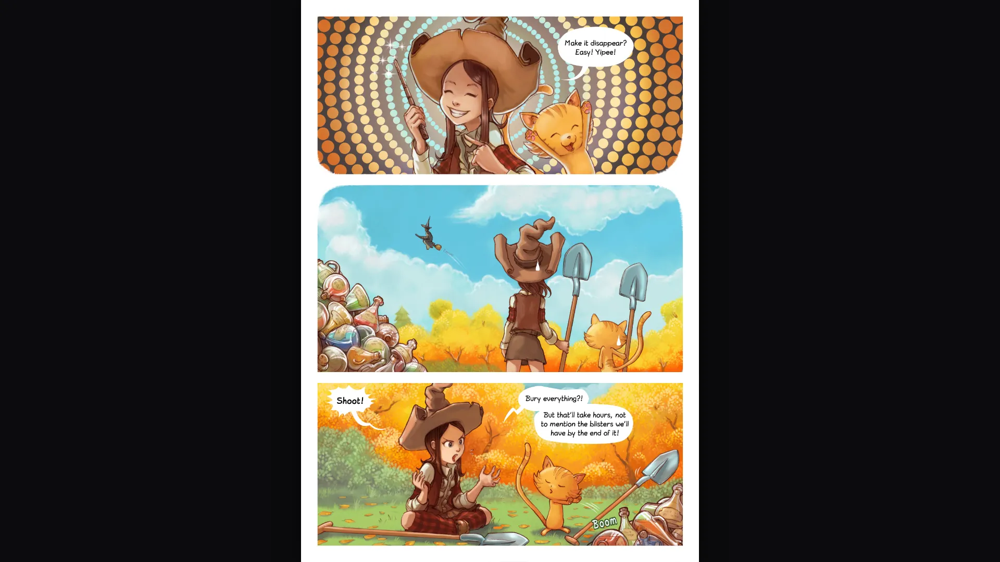
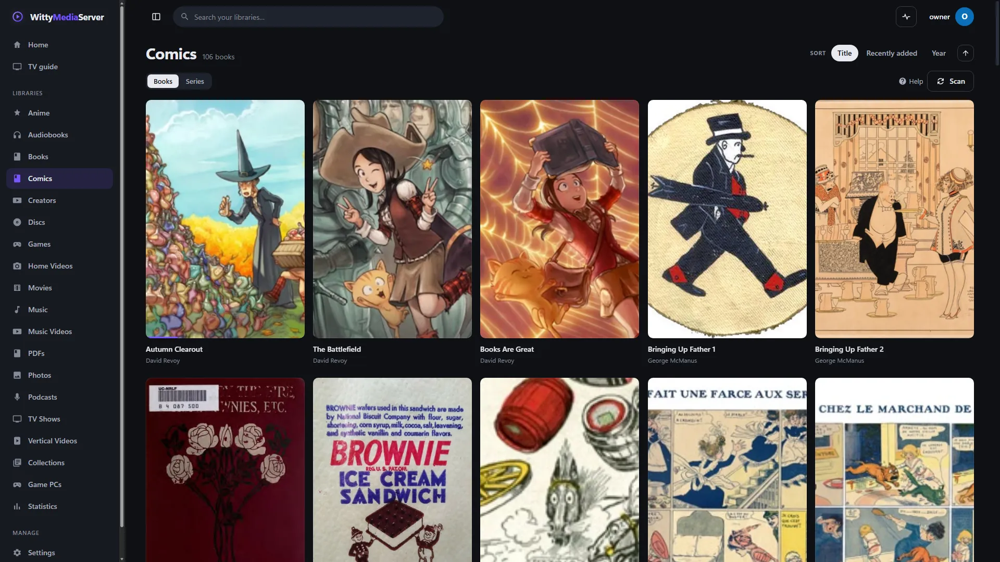

# WittyComics

A reader for comics, manga and webtoons. You need it to read comics in WittyMediaServer.

<!-- pictures -->



<sub>[Pepper&Carrot](https://www.peppercarrot.com/), David Revoy, [CC BY 4.0](https://creativecommons.org/licenses/by/4.0/).</sub>



<sub>A shelf of comics in WittyMediaServer. [Pepper&Carrot](https://www.peppercarrot.com/), David Revoy, [CC BY 4.0](https://creativecommons.org/licenses/by/4.0/), and public-domain strips.</sub>

<!-- /pictures -->

## What it does

- **Page, Spread or Scroll:** one page, two side by side with the cover alone so pairs line up as printed, or one vertical strip for webtoons.
- **Either direction:** left to right, or right to left for manga. Arrows, taps, swipes and the slider all follow it.
- **Fit height or width:** a whole page on screen, or tall pages read top to bottom.
- **Easy to turn:** tap the outer thirds, swipe, or use the arrows, Space, Page Up, Page Down, Home and End. Tap the middle for the bars.
- **Smooth:** the next three pages are fetched ahead.
- **Remembered per book:** layout, direction and fit, and it reopens on the same page.

The settings are in one **Reading** panel behind the gear button.

The Reader page, and how the server opens comic archives, stay with the server. No comics come with it.

How to use it is in **Help** inside WittyMediaServer: see Books, PDFs and comics.

## How to get it

An admin adds it from the module store inside WittyMediaServer: **Settings → Modules**, then **Browse the store**, then **Add** beside WittyComics. That needs WittyMediaServer 0.6.0-alpha or later, and it works with nothing older. The range this version fits is in `module.json`: 0.6.0-alpha through 0.6.x.

Adding it brings WittyInk, which it's built on.

## What it needs

[WittyInk](https://github.com/wittywilla/WittyInk), and React 18 or newer, which the app provides.

## Platforms

It's one browser bundle for every system the server runs on, and it runs on whichever device opens the server. It has been seen working in a desktop browser, against a test server on Linux. It also runs in the WittyReader app. Safari, real phones and real TVs have not been tried.

## Building and testing

You need Node.js 22, as CI uses, and Go for the manifest check. In a worktree, first run the copy of `dev-modules.mjs` kept above the repositories (`node D:/projects/dev-modules.mjs` on the development machine). It writes only links that git ignores, so the checkout builds against the repositories beside it.

```bash
npm install
```

```bash
npm run build:bundle
```

That makes one script and one stylesheet, as a server installs them. To check the manifest:

```bash
go run github.com/wittywilla/wittymodule/cmd/wittymodule check .
```

It has no tests of its own yet. CI checks the manifest and builds the bundle.

To use it in another app, give it a `ReaderHost` whose `comic` field lists the pages, and set `reading` to `rtl` or `webtoon` to choose the first layout: see [Embedding](wiki/Embedding.md) and the rest of [wiki/](wiki/Home.md).

## Licence

GNU Affero General Public License v3.0 (or later): see [LICENSE](LICENSE) and [NOTICE](NOTICE). If you redistribute it or build on it, please keep the NOTICE attribution.


## In every app: its server-driven UI

It carries its own `sdui.json`: its theme scope, and **Settings, Comics** (each profile's own): the layout, direction and fit a comic opens with the first time. Its library and book pages come with WittyInk, which every reader shares.

**Stays in the reader's own code:** the reading surface: pages, spreads and the vertical strip.

The file is checked with `wittymodule check` and described in WittyMediaServer's [docs/SDUI-MODULES.md](https://github.com/wittywilla/WittyMediaServer/blob/master/docs/SDUI-MODULES.md).

## Legal

WittyComics is an independent open-source project. It isn't associated with, sponsored by or
endorsed by any publisher, rights holder, service or other media software project. No comics come
with it, and it doesn't check the ones you open: you're responsible for having the rights to them.
Any third-party names here only describe what it works with, and belong to their owners. It's
provided “as is”, with no warranty; see [LICENSE](LICENSE). Local law applies to how you use it.
This isn't legal advice.

<!-- module-kit -->
## Releasing

A version tag builds the bundle for the browser, signs the checksum list, and publishes a release that servers can install.

Versions move in small steps as work lands. `go run github.com/wittywilla/wittymodule/cmd/wittymodule@v0.4.0 bump .` raises it
everywhere it is written (add `-part minor` for a bigger step). A bump isn't a release: nothing is
tagged or published until you tag it. CI fails when code changed since the last tag and the version
didn't, because tags never move.

To release:

1. Check that `version` in `module.json` is the one to publish, with the bump committed.
2. Tag that commit and push the tag: `git tag vX.Y.Z`, then `git push origin vX.Y.Z`. A tag with a
   suffix, such as `v1.2.0-beta`, is published as a prerelease.
3. Watch the *Actions* tab. The signing step uses the `WMS_SIGNING_KEY` secret of the `release` environment, and nothing is published without it.

To take a version back, run the *withdraw* workflow from the *Actions* tab. It adds the version to a signed list on the release tagged `withdrawals`, which servers read.

Licensed under AGPL-3.0-or-later: see [LICENSE](LICENSE) and [NOTICE](NOTICE).
<!-- /module-kit -->
